# Draftfit

[English](README.md) | [한국어](README.ko.md)

**Train speculative decoding drafts for your model, your workload, your data.**

**DSpark · DFlash · DFlash2 · EAGLE3 · PEagle · Domino**

[Quick start](#quick-start) · [Joint training](#joint-training-and-unattended-runs) · [Draft methods](#draft-methods) · [Backends](#backends) · [Example models](#example-models) · [Documentation](docs/README.md)

Draftfit helps individual developers and agent builders train a smaller draft
for the tasks their LLM actually handles. Start with your conversations, choose
a target and draft method, then train, export and benchmark through one CLI.
Inference teams and researchers can use the same workflow to compare methods.

Your target stays frozen. The draft proposes tokens; the target verifies them.
**Your workload. Your draft.**

Source release **0.2.0** · [Changelog](CHANGELOG.md) · [Upcoming work](plans/README.md)

https://github.com/user-attachments/assets/ba787371-e71f-4413-aa03-d697090ccbb1

[Watch the 29-second workflow overview](https://github.com/JayYun98/Draftfit/releases/download/v0.2.0/draftfit-system-demo-en.mp4) — an illustrated workflow, not a measured speedup demo.

## Why Draftfit?

- **Use your own data.** Prepare reviewed conversation exports with a separate holdout set.
- **Make the draft yours.** Configure the target, draft method, depth, feature layers and block size; fine-tune a compatible existing draft or train a new one.
- **Share the expensive work.** Capture frozen-target features once per microbatch and jointly train a compatible DSpark/DFlash/DFlash2 backbone with separate method heads. Independent runs and offline features remain available.
- **Run bounded experiments.** Use a RAM feature queue, fixed-holdout verification, early stopping, registered batch/LR phases and durable best/latest exports. Optional background HF publication preserves retry receipts.
- **Measure what matters.** Compare end-to-end throughput on your workload—not just training loss or token acceptance. Speedup is measured, not promised.

```text
Your conversations → Prepare → Capture → Train → Export → Benchmark
                              teacher    draft            vs target only
```

## Quick start

[Install the matching uv environment](docs/ENVIRONMENT.md) first. In a provisioned
runtime, prepare your reviewed conversations and a DSpark training project:

~~~sh
draftfit data prepare --input ./my-conversations.jsonl \
  --output ./data/train.jsonl --split-eval --eval-output ./data/holdout.jsonl

draftfit target prepare /path/to/target --local-only \
  --strategy dspark --train-data ./data/train.jsonl --output-dir ./my-draft

draftfit train -c ./my-draft/train.json --plan
draftfit train -c ./my-draft/train.json
~~~

This online example defaults to GPU 0 for the teacher and GPU 1 for training.
For saved-feature training, existing-draft fine-tuning, recovery and export,
follow the [complete workflow](docs/PUBLIC_WORKFLOW.md).

## Draft methods

| Method | Offline features | Online capture | Key requirement |
| --- | --- | --- | --- |
| DSpark | Yes | Yes | Auxiliary taps and final target hidden states |
| DFlash | Yes | Yes | Compatible hidden features and mask token |
| DFlash2 | Yes | Yes | Full vocabulary; convolution and selector training |
| EAGLE3 | Yes | Yes | One draft layer; vocabulary mapping for online training |
| PEagle | No | Yes | Flex attention and method-specific feature layout |
| Domino | Yes | Yes | Explicit compatible draft configuration |

Optional [research methods](docs/specs/research-methods.md) add ALR/IRA rollout
distillation, Osprey backbone conversion, CAST reference tree decoding and Redline
configuration selection. Each has its own input and runtime limits; these are
explicit experimental workflows.

Three main paths are available: train a family from scratch, initialize compatible
families from an existing draft, or continue a saved run. Weight transfer between
families requires compatible layouts and, where applicable, explicit anchor
realignment and retraining. It does not guarantee unchanged quality. Exact resume
also restores optimizer/RNG/cursor state; a weights-only warm start does not.
See the [family guide](docs/DFLASH_FAMILY.md).

## Joint training and unattended runs

A single-device joint run shares a backbone and target features across compatible
DSpark/DFlash/DFlash2 arms, then exports each method separately:

```sh
draftfit family --manifest family.json --joint --plan
draftfit family --manifest family.json --joint
```

For automatic milestone decisions, use a prepared
[unattended configuration](docs/UNATTENDED_NATIVE.md):

```sh
draftfit unattended --config controller.json --plan
draftfit unattended --config controller.json
# Recover the same run after interruption.
draftfit unattended --config controller.json --resume
```



The user supplies the supported target/draft configuration, tokenized data,
explicit limits and fresh external cost observations. Scratch and compatible
existing-draft initialization use the same pipeline. Current native selection is
based on loss or acceptance; batch/LR changes choose predeclared phases.
Capture and training alternate synchronously. Production-speed optimization,
automatic architecture search and guaranteed GPU saturation are not provided.

Native verification keeps the target resident; an optional bounded SGLang
handoff offloads training models, runs a separate engine, confirms cleanup and
restores training. Native timings are reference diagnostics, and short engine
smokes do not certify long-output parity or speedup. Longer-output serving parity
remains an open gate. See [joint setup](docs/JOINT_ONLINE.md),
[queue and verification](docs/SHARED_TARGET_FEATURE_QUEUE.md) and
[monitoring](docs/JOINT_MONITORING.md).

Before a longer run, use [batch calibration and runtime forecasts](docs/CALIBRATION.md)
to measure capture plus joint updates, preserve effective batch size and account
for checkpoint, evaluation and verification costs. An optional forecast admission
check stops at a saved boundary when the next interval cannot fit. The
[local web workspace](docs/WEB_WORKSPACE.md) displays current engine plans, jobs
and saved evidence from a source checkout.

## Backends

All teachers feed the same **PyTorch draft trainer**. These levels describe
implementation and retained evidence—not universal production certification.

| Component | Role | Support level | Validation scope |
| --- | --- | --- | --- |
| PyTorch | Draft trainer | Core | Training, same-world resume and export; FSDP1 default, FSDP2 opt-in |
| SGLang | Offline / online teacher | Maintained, validated configurations | Real Ling capture, training and bounded pinned serving/state checks |
| Hugging Face Transformers | Offline / online teacher | Native, bounded GPU validation | Qwen3-0.6B BF16 feature parity; DSpark/DFlash2 train/resume/export |
| vLLM | Offline / online teacher | Native, experimental | Qwen3-0.6B FP32 parity and train/resume/export; **BF16 parity failed** |
| MLX | Optional offline teacher / external evaluation | Experimental capture adapter | Input and readout contracts checked; actual MLX capture requires separate Apple Silicon validation; not a draft trainer |
| Prism GGUF | Explicit local joint teacher | Experimental native adapter | Pinned extended runtime, immutable source hashes and bounded context required; full native target execution remains a separate gate |
| TensorRT-LLM / TokenSpeed | Teacher | Not implemented | No integration in this release |

Native vLLM capture targets single-device Llama/Qwen2/Qwen3 text decoders.
Transformers has additional architecture-specific paths with separate support
boundaries. Teacher support does not imply exported-draft serving correctness;
DSpark/DFlash/DFlash2 live-engine checks remain bounded and do not certify
production speed or long-output parity.
[Backend requirements and method limits →](docs/PUBLIC_SUPPORT.md)

## Example models

Examples are starting configurations—not a promise that every model × method
combination works. “Real-weight” below means bounded functional checks, not
production or speedup certification.

| Target type | Current example | Available evidence |
| --- | --- | --- |
| Dense + KV | [Qwen3-8B](configs/qwen3-8b-dspark.json), [Llama3-8B](configs/llama3-8B-eagle3.json) | Config recipes; separate Qwen3-0.6B real-weight DSpark/DFlash2 train/resume/export checks |
| MoE + KV | [Qwen3-30B-A3B](configs/qwen3-30B-A3B-eagle3.json) | Config recipe; prior TP2 MoE capture used dummy weights |
| MoE / conv hybrid | [Ling-3.0-tiny](configs/ling-3.0-tiny-dspark.json) | Real-weight DSpark capture/train/export and bounded pinned serving/replay |
| Linear + KV hybrid | [Qwen3.5-4B](configs/qwen3.5-4b-dflash.json) | Config recipe; full target workflow not certified |
| Conv + KV | [LFM2.5-1.2B-Instruct](configs/lfm2.5-1.2b-instruct-dflash.json) | Real-weight load/chat smoke only; draft workflow pending |
| Recurrent | [RWKV7-1.5B](configs/target_specs/rwkv7-1.5b.json) | Metadata/state fixture only; requires a compatible backend |

See [all recipes](examples/configs/README.md), [exact validation scope](docs/MODEL_VALIDATION.md),
and [planned recent-model experiments](plans/README.md).
Add models through [target configuration and adapters](docs/TARGET_EXTENSION.md);
configuration alone cannot add an unsupported capture or serving backend.

## Documentation

| I want to… | Guide |
| --- | --- |
| Install or select a teacher backend | [Environment setup](docs/ENVIRONMENT.md) |
| Prepare data, train, fine-tune, resume and export | [Complete workflow](docs/PUBLIC_WORKFLOW.md) |
| Configure a new target or runtime | [Target extension](docs/TARGET_EXTENSION.md) · [Runtime profiles](docs/RUNTIME_PROFILES.md) |
| Compare target-only and draft-enabled inference | [Workload evaluation](docs/PERFORMANCE_GATE.md) |
| Check supported and unverified combinations | [Support matrix](docs/PUBLIC_SUPPORT.md) |
| Develop or reproduce validation | [Documentation index](docs/README.md) · [Source tools](tests/VALIDATION.md) |
| Share features and train a family backbone | [Joint online](docs/JOINT_ONLINE.md) · [Queue and verification](docs/SHARED_TARGET_FEATURE_QUEUE.md) |
| Run automatic bounded experiments | [Unattended controller](docs/UNATTENDED_NATIVE.md) · [External campaigns](docs/FAMILY_CAMPAIGN.md) |
| Measure initial batch size and forecast time/cost | [Calibration](docs/CALIBRATION.md) |
| Capture an explicitly supported packed teacher | [Quantized capture](docs/specs/quantized-capture.md) |
| Try rollout distillation, conversion or tree decoding | [Research methods](docs/specs/research-methods.md) |
| Inspect plans and jobs in a local browser | [Web workspace](docs/WEB_WORKSPACE.md) |
| Inspect decisions or upload selected exports | [Monitoring](docs/JOINT_MONITORING.md) · [HF publication](docs/HF_PUBLICATION.md) |
| Compare recent-target draft families | [Family workflow](docs/DFLASH_FAMILY.md) · [MiniCPM5 results](docs/RECENT_TARGET_BRANCH_SUMMARY.md) |

Automatic trace ingestion and continual deployment are [future work](plans/README.md).
A longer accepted draft is not necessarily faster: measure end-to-end throughput
on held-out requests and verify correctness separately.

## Acknowledgments

Draftfit ships its own maintained training runtime derived from
[SpecForge](https://github.com/sgl-project/SpecForge), with attributed adaptations
and references from [TorchSpec](https://github.com/lightseekorg/TorchSpec),
[AngelSpec](https://github.com/Tencent/AngelSpec) and DSpark-related projects.
See [code ownership](docs/CODE_OWNERSHIP.md), [third-party notices](THIRDPARTY_NOTICES.md)
and [license](LICENSE).
