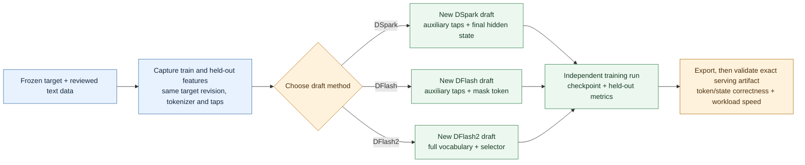
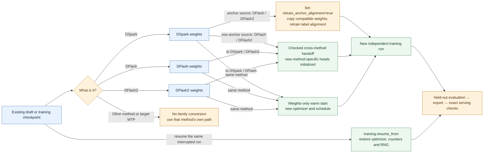
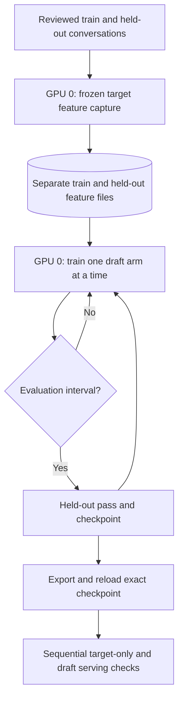
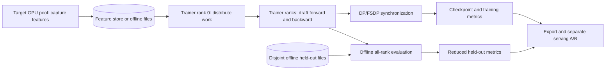

# DSpark / DFlash family: starting and continuing a draft

Draftfit trains **DSpark, DFlash and DFlash2 as separate draft methods** against a
frozen target. The `family` command can run a sequential experiment matrix from
one compatible pair of offline training and held-out feature caches. Each arm
has its own configuration, optimizer, checkpoint and evaluation metrics. A
checkpoint handoff copies compatible **weights**; it is not a universal draft
that serves as all three methods. See the [MiniCPM5 example and evidence](RECENT_MODEL_EXPERIMENTS.md#one-command-minicpm5-matrix).

## No existing draft



Use `draftfit target prepare` with `--strategy dspark`, `--strategy dflash` or
`--strategy dflash2` and a suitable draft config, then `draftfit train -c ...`.
For a matrix, `draftfit family
--manifest family.json --plan` validates the shared offline sources before
`draftfit family --manifest family.json` runs stages in order. A DSpark superset
cache with `target_last_hidden_states` can also supply DFlash/DFlash2 when the
target, layers, tokenizer and mask contracts match. A different tap layout needs
separate capture. The family runner requires disjoint train/held-out sources and
`training.eval_interval`; it stops on a failed stage or missing checkpoint or
held-out loss/accuracy. It does not perform export or serving validation.

## Raw-text pretraining

[Speculators RFC #1127](https://github.com/vllm-project/speculators/issues/1127)
proposes an inexpensive first stage before verifier distillation. Draftfit now
offers a **single-device** version for Qwen3-shaped DSpark, DFlash and DFlash2:
it loads only the frozen target embedding and LM head, packs local JSONL `text`
rows with EOS separators, and trains from hard next-token labels. It does not
run the target decoder or create verifier hidden-state features. Use a separate
held-out file; up to 32 full sequences are checked by default.

```sh
draftfit pretrain --target /path/to/pinned-target \
  --draft-config configs/minicpm5-2b-dflash2.json --strategy dflash2 \
  --corpus /path/to/train-text.jsonl --validation /path/to/heldout-text.jsonl \
  --output ./pretrained-one-tap --steps 100 --sequence-length 256
draftfit expand-aux-layers --checkpoint ./pretrained-one-tap \
  --target-layer-ids 0 10 21 31 41 --output ./pretrained-five-taps
draftfit target prepare /path/to/pinned-target --local-only --strategy dflash2 \
  --hidden-states /path/to/matching-on-policy-features \
  --draft-checkpoint ./pretrained-five-taps --output-dir ./distill-run
draftfit train -c ./distill-run/train.json
```

The pretrain output is an ordinary draft checkpoint with one auxiliary tap,
layer 0. Expansion copies that projection into the layer-0 slot and zeroes
the new columns, preserving the embedding-only function mathematically. A wider
matrix multiplication can still differ by floating-point rounding; bitwise
output parity is not promised. The
subsequent `draftfit train` run loads weights only; it starts a new optimizer.
Use the same target weights/tokenizer, block size, anchor alignment, attention
layout and expanded tap list as the feature capture. The expanded list must
include tap 0; recapture features if an existing cache omits it. `summary.json` and
`metrics.jsonl` record loss, accuracy, gradient norm and position-wise hard-token
diagnostics. DSpark's hard-label pretraining uses point-mass TV and confidence
targets; these are corpus proxies, not verifier acceptance measurements.

This path has no multi-GPU sharding, optimizer resume or target embedding
scaling for Gemma/Granite. A held-out distillation A/B and exact serving check
are still needed to establish quality or speed. TorchSpec's
[conversion tool](https://github.com/lightseekorg/TorchSpec/blob/main/tools/convert_to_torchspec.py)
also treats shared tensor transfer as a warm start. Its token/position-aware
training metrics informed our DFlash-family position-wise CE and accuracy
telemetry; neither converter promises zero-step quality parity.

## Existing draft: identify the source first



| Source | Implemented route | Boundary |
| --- | --- | --- |
| Same-method DSpark, DFlash or DFlash2 | `model.draft_checkpoint_path` / `--draft-checkpoint`; weights-only warm start | Source draft config and required tensor shapes must match. New optimizer, schedule and step count. |
| DSpark with `sample_from_anchor=true`, including the official MiniCPM5 draft | Same-method DSpark warm start; or explicit DSpark → DFlash/DFlash2 initialization | Cross-method path requires `training.retrain_anchor_alignment=true`, sets destination `sample_from_anchor=false`, and needs new training. Copied weights do not imply zero-step prediction or acceptance parity. |
| Non-anchor DSpark, DFlash or DFlash2 | Checked conversion among these three methods | Full compatible shared layout, vocabulary, taps, mask and feature contract are required. DSpark heads or DFlash2 convolution/selector tensors are newly initialized when absent. No generic checkpoint conversion guarantee. |
| Same interrupted training run | `training.resume_from` | Restores training state; cannot be combined with `model.draft_checkpoint_path`. The `family` runner uses weights-only stage handoffs, not full resume. |
| EAGLE3, PEagle, Domino, target MTP head or unrelated checkpoint | No DSpark/DFlash family handoff | A matching method-specific workflow or new draft is needed. Taichu's published `speculators` checkpoint is not supported by the new-draft recipes. |

The family manifest accepts an external `checkpoint` or `from` an earlier arm,
never both in one arm. Cross-method handoff requires compatible architecture,
block size, hidden width, layer count, full vocabulary where DFlash2 needs it,
attention layout, target taps, mask ID and relevant alignment settings. Invalid
combinations fail during planning or loading. Explicit draft configs need to
match the chosen method; changing `training.strategy` alone does not convert a
draft. Refer to [the workflow guide](PUBLIC_WORKFLOW.md#fine-tune-weights-versus-resume-a-run)
for the individual-run commands.

## Training and validation by GPU count

### One GPU: capture, train, then serve



The offline path reuses one GPU by capturing features before training. Train
and held-out files must be disjoint and use the same target revision, tokenizer,
tap layers and mask contract. The `family` runner executes its arms in order;
held-out loss and token accuracy check training, while the exported draft needs
separate token/state parity and throughput checks.

### Multiple GPUs: separate capture and trainer pools



In an online producer/consumer run, the target producer and draft trainer use
separate GPU resources; the selected deployment config determines rank and
device placement. The current online path records training metrics and
checkpoints, but does not wire a held-out evaluation source into that run. Use
offline held-out features for that gate. Offline multi-GPU evaluation reduces
counts across ranks before reporting ratios. See the [runtime architecture](../draftfit/runtime/ARCHITECTURE.md)
and [disaggregated training guide](basic_usage/disaggregated_training.md).

For either layout, compare the exact exported artifact with target-only and
the official draft on the same prompts and serving settings. Record token IDs,
accepted length, latency, throughput and peak memory; a lower training loss is
not a serving speed result. The MiniCPM5 outcomes and missing gates are in the
[experiment record](RECENT_MODEL_EXPERIMENTS.md).

## Status of the broader family proposal

| Claim | Status |
| --- | --- |
| One offline cache and sequential DSpark/DFlash/DFlash2 runs, per-arm checkpoints and held-out metrics | Implemented in [`draftfit/family.py`](../draftfit/family.py), subject to matching feature contracts. |
| Same-method warm start, guarded cross-method weight handoff, DSpark head-only/EAL/WTV and DFlash DPACE experiment settings | Implemented in the current code; the [MiniCPM5 record](RECENT_MODEL_EXPERIMENTS.md#gates-and-observations-2026-09-30) separates CPU checks from pending real training and serving. |
| A generic backbone trained once and directly reusable as every serving method | Research idea, not implemented. Each method still needs its own training and export. |
| DFlow, Carryover, DScale and DPara | Names for future research directions only; no registered family training or serving route is claimed here. |
| Universal model support or speedup | Unverified. Exact target revision, capture backend, draft and serving backend must pass real artifact reload, token/state checks and workload A/B measurement. |

The implementation boundaries are defined by
[`convert_family_draft_config` and `warm_start_draft_model`](../draftfit/training/model_loading.py),
[`prepare_project`](../draftfit/target_project.py) and the
[`family` CLI](../draftfit/cli.py). The current MiniCPM5 original-weight checks
cover CPU loading and transfer, not real MiniCPM training or serving. Earlier
DFlash2 CUDA training evidence applies only to its recorded target/runtime;
see [model validation](MODEL_VALIDATION.md).
