# Shared target features, queueing and milestone verification

The online joint runner shares the **original frozen-target features**, then
applies each family's alignment, mask and objective in the training path.
Feature sharing and backbone sharing are distinct concepts; the `--joint`
runner implements both for compatible DSpark/DFlash/DFlash2 arms.

## Feature identity and memory ownership

Reuse requires the same target weights, tokens, attention and position
conditions, precision, capture locations and normalization. Layer numbers
alone are insufficient. DFlash and DFlash2 use auxiliary hidden states;
DSpark additionally uses final normalized hidden states. The current joint
runner requires matching layer selections rather than capturing their union.

`training.joint_feature_queue_bytes` bounds queued **and leased** feature
payloads. `training.joint_feature_queue_batches` must cover at least
`accumulation_steps`. Features are acknowledged only after all arms' backward
passes and the optimizer update succeed. The queue keeps no feature files.

This limit does not cover target weights, model activations, optimizer state,
loaded token rows or inference KV caches. This is synchronous prefetch with
short capture/training alternation, not an asynchronous GPU producer generating
responses continuously. It cannot guarantee full GPU utilization.

## Checkpoint and recovery boundary

The durable cursor follows committed consumption, not producer lookahead.
After interruption, unconsumed prefetched features are recaptured from the
retained token source. Work after the last durable checkpoint can be replayed;
lookahead must never cause data to be skipped. Preserve the input token files
and their identity across resume. This runner does not delete their journals
or generate replacement responses automatically.

Checkpoints retain optimizer/RNG/cursor state. HF arm exports retain inference
weights and configuration. Keep both when exact continuation is required.
[Unattended execution](UNATTENDED_NATIVE.md) binds the best and latest verified
exports to their source checkpoints and rejects mutated sources on resume.

## Milestone memory and process lifecycle

## Native milestone verification

1. Save the checkpoint and committed cursor.
2. Move optimizer state, FP32 master parameters and saved training gradients
   to CPU when configured; keep the frozen target resident on the device.
3. Compare target-only, optional existing drafts and current family drafts on
   the same fixed holdout workload.
4. Record exact token parity, acceptance counts and per-domain timings.
5. Restore training state, modes and RNG, then apply the policy decision.

The native path uses full-prefix generation without an inference KV cache.
Its report identifies `timing_scope=full_generation_including_prefill_no_kv_cache`
and `production_engine_speed=false`. These timings are diagnostics, not an
optimized serving benchmark. Acceptance counts committed speculative suffix
tokens against proposed suffix tokens; the anchor is excluded. Teacher-forced
accuracy is a different metric.

For native existing-draft comparisons, supply a local compatible export for
each arm in `training.joint_verification.existing_drafts`. This requires the
supported offload configuration and matching geometry. Existing drafts are
comparison baselines, not candidates for best-model selection. Inactive
family parameters are not all unloaded, so measure the actual memory peak.

## Optional SGLang handoff

The unattended controller can instead invoke a bounded live SGLang comparison
at milestones. This path offloads ordinary Torch target/draft models and
optimizer state to CPU, starts a separate serving process, verifies the report,
and restores training **only after serving-process cleanup is confirmed**.
An ownership guardian handles parent loss. Uncertain cleanup causes fail-stop
(exit code 70), rather than risking two owners of the GPU.

This external-engine path reloads the target; it is different from native
verification that keeps the same target instance resident. It currently covers
ordinary HF dense models on one CUDA device, supported BF16 serving, and
DSpark/DFlash/DFlash2. It does not support packed/GGUF targets, distributed
handoff or the controller's existing-draft mapping. Runtime/model identity and
report hashes are checked, but bounded smoke timing is not a production speed
selection signal. See [configuration and limits](UNATTENDED_NATIVE.md).

Native CPU tests exercise lifecycle and recovery logic. CUDA and actual-engine
checks are separate gates; neither a queue unit test nor a successful short
serving sample establishes long-output parity or throughput improvement.
